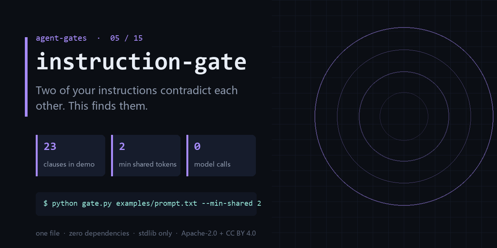

<div align="center">

</div>

<h1 align="center">instruction-gate</h1>

<p align="center"><b>Two of your instructions contradict each other. This finds them.</b><br><sub>one file · zero dependencies · stdlib only</sub></p>

<p align="center"><a href="https://github.com/chenhz01/instruction-gate/actions/workflows/gate.yml"></a>   </p>

---

## The failure this catches

- AGENTS.md says 'always write tests'; another section says 'keep changes minimal, add no files'.
- The system prompt says 'ask when unsure' and, four lines later, 'never ask, just act'.
- Every new rule quietly overrides an older one, and the prompt only ever grows.

One command, on a file you already have:

```bash
python gate.py examples/prompt.txt --min-shared 2
```

<details>
<summary><b>Real output</b> — produced by the bundled <code>examples/</code>, not a mock-up</summary>

```text
[ERROR] rule 3 / rule 8 DIRECT_CONFLICT: rules 3 and 8 conflict on ['changes'] (positive vs negative)
summary: 1 error(s), 0 warn(s), 0 info(s)
```

</details>

## What it does

- Extracts clauses and flags pairs that share action vocabulary but oppose polarity.
- Tunable `--min-shared`, so you can trade recall for noise on long prompts.
- Zero-dependency single file — drop it into a pre-commit hook today.

## What it does **not** do

- It cannot read intent. 'Don't be verbose' and 'explain in detail' may or may not conflict.
- It does not fix prompts, it points at the pair.
- Chinese and English are handled by lexicon, not a model — rare phrasings will be missed.

Being explicit here is cheaper than a wrong expectation later.

## Exit codes

`0` = clean, `1` = findings. Gate your pipeline on `$?`.

## Install

```bash
git clone https://github.com/chenhz01/instruction-gate
cd instruction-gate
python gate.py --help
```

Python 3.9+. Nothing to `pip install` — stdlib only.

## Use it in CI

```yaml
- name: instruction-gate
  run: python gate.py examples/prompt.txt --min-shared 2
```

`action.yml` is included, so you can also reference the repo directly as a composite action.

## 中文速览

**指令门** — 你写的两条指令互相打架，这个把它找出来。

- AGENTS.md 里写着「必须写测试」，另一段写着「改动最小化，不要新增文件」。
- 系统提示说「不确定就问用户」，又说「不要反问，直接执行」。
- 提示词越改越长，每次加一条，都在悄悄推翻前面某一条。

一行命令：`python gate.py examples/prompt.txt --min-shared 2`

边界：It cannot read intent. 'Don't be verbose' and 'explain in detail' may or may not conflict.

## The gates

| # | gate | what it stops |
|---|---|---|
| 02 | **[loop-gate](https://github.com/chenhz01/loop-gate)** | Find where your agent looped, before it burns another run |
| 03 | **[permission-gate](https://github.com/chenhz01/permission-gate)** | Score how much more your agent can do than it should |
| 04 | **[context-gate](https://github.com/chenhz01/context-gate)** | Measure what truncation deletes, before the model starts guessing |
| 05 | **instruction-gate** ← you are here | Two of your instructions contradict each other. This finds them |
| 06 | **[output-gate](https://github.com/chenhz01/output-gate)** | Before AI-written text ships, run the four checks it always fails |
| 07 | **[memory-expiry-gate](https://github.com/chenhz01/memory-expiry-gate)** | Give every memory a TTL, then prove the expiry semantics actually hold |
| 08 | **[drift-gate](https://github.com/chenhz01/drift-gate)** | When embeddings drift, retrieval quietly rots. Fingerprint it |
| 09 | **[price-gate](https://github.com/chenhz01/price-gate)** | Your cost model is only as good as the price table under it |
| 10 | **[complexity-ceiling](https://github.com/chenhz01/complexity-ceiling)** | Per-file complexity budgets that fail the build instead of the reviewer |
| 11 | **[deadcode-gate](https://github.com/chenhz01/deadcode-gate)** | Quantify how much of the repo is dead, instead of guessing |
| 12 | **[docrot-gate](https://github.com/chenhz01/docrot-gate)** | Docs don't die at once. They rot one stale command at a time |
| 13 | **[leak-gate](https://github.com/chenhz01/leak-gate)** | Scan for internal detail before the doc leaves the building |
| 14 | **[backup-gate](https://github.com/chenhz01/backup-gate)** | A backup you have never verified is a rumor |
| 15 | **[trail-gate](https://github.com/chenhz01/trail-gate)** | Hash-chained agent audit trail — and it verifies its own chain |

## License

- Code: **Apache-2.0** — see [LICENSE](LICENSE)
- Docs and example data: **CC BY 4.0** — see [LICENSE-SPEC](LICENSE-SPEC)

Attribution required when you redistribute the documentation; code can be used commercially
without a separate agreement. See [NOTICE](NOTICE).
